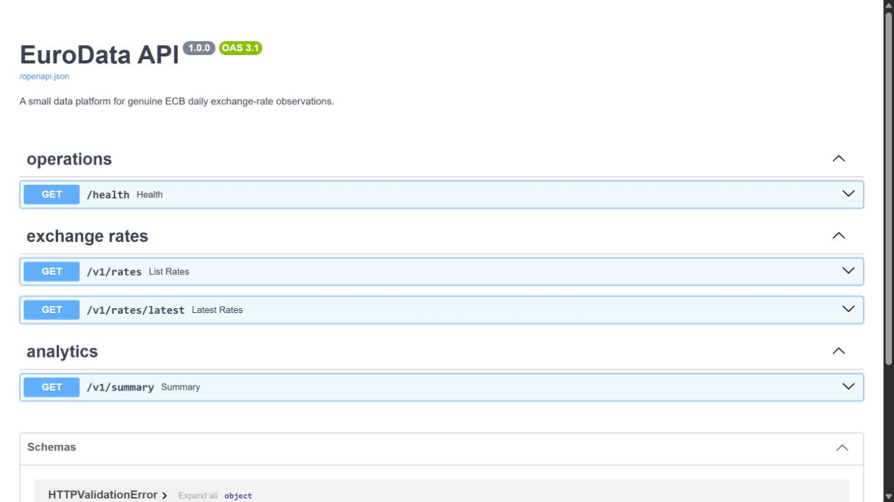
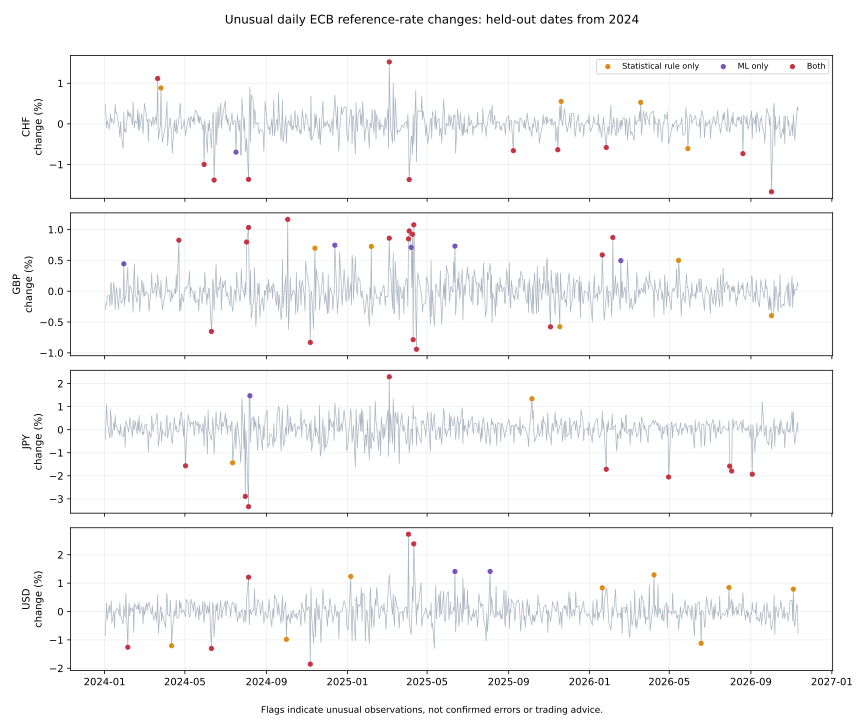

# EuroData Pipeline

This project downloads exchange rates from the European Central Bank, stores them in a database and makes them available through an API. It also plots daily changes and flags days that look unusual.

If the euro usually moves a little against the dollar but suddenly moves much more, the chart can mark that day for a closer look. A flag does not mean the rate is wrong.

## API interface

The interactive API documentation runs locally at `/docs` and lets you inspect and try the available endpoints.



## Anomaly detection

Isolation Forest learns patterns in past exchange rate changes. It uses the daily percentage change, that change compared with the previous 60 observations, and recent volatility compared with the previous 60 observations. A simpler statistical rule provides a comparison.

Each currency has its own model. Training uses observations through 2022. Rates from 2023 set both thresholds at the 98th percentile. Those thresholds stay fixed when checking dates from 2024 onwards. The current published rate is needed before a day can be scored, so this detects unusual movements after publication rather than predicting tomorrow.

## Data and results

The snapshot contains 7,036 ECB observations from 2 January 2020 to 11 November 2026 for USD, GBP, JPY and CHF. Rates are foreign currency units per euro. A USD rate of 1.12 means one euro equals 1.12 dollars at that reference rate.

The download URL, retrieval time and file checksum are in `data/ecb_reference_rates.source.json`. This is a historical snapshot, not a continuously updating live feed.

Each currency has 732 test observations.

<table>
<tr><th>Currency</th><th>Statistical flags</th><th>ML flags</th><th>Both</th></tr>
<tr><td>CHF</td><td>15</td><td>12</td><td>11</td></tr>
<tr><td>GBP</td><td>21</td><td>21</td><td>16</td></tr>
<tr><td>JPY</td><td>11</td><td>10</td><td>9</td></tr>
<tr><td>USD</td><td>14</td><td>8</td><td>6</td></tr>
</table>



These counts describe what each method flagged. There are no confirmed anomaly labels, so they do not measure accuracy or prove ML is better. Genuine market events can cause unusual movements. Scores are not probabilities of an error.

## Run it

Use Python 3.11 or newer. From the project folder:

```powershell
py -3.12 -m venv .venv
.\.venv\Scripts\Activate.ps1
python -m pip install -e ".[dev,anomaly]"
python -m eurodata_pipeline.anomalies
```

The anomaly command works offline with the included real snapshot. It writes the chart, scored observations, summary and method settings to `results/anomalies`. Library updates can cause small differences in results.

To download current rates into the database and start the API:

```powershell
python -m eurodata_pipeline.cli --start-date 2020-01-01 --verbose
uvicorn eurodata_pipeline.api:app --reload
```

Open http://127.0.0.1:8000/docs to try the API. The database and anomaly snapshot are separate. Ingestion does not replace the snapshot or regenerate the chart.

For another ECB snapshot, save a CSV with the same columns as `data/ecb_reference_rates.csv`, keep its source URL and retrieval date, then run:

```powershell
python -m eurodata_pipeline.anomalies --input path/to/rates.csv --output results/new_run
```

The file needs enough observations before 2023, during 2023 and after 2023 for training, threshold selection and testing.

## API and storage

`GET /health` checks the database. `GET /v1/rates` returns rates with currency and date filters, plus limit and offset for pagination. `GET /v1/rates/latest` returns the latest stored rates. `GET /v1/summary` returns counts and date coverage.

Running ingestion again does not duplicate observations. Revised rates update existing rows. SQLite is the default. PostgreSQL can be configured through `DATABASE_URL`.

## Checks

```powershell
pytest -q
ruff check src tests
```

The anomaly tests use the included ECB observations. They check that later dates cannot change earlier features, scores or thresholds, and that exported rates match the source. Existing database and API tests use small fixtures to check storage behaviour. Those fixtures are not used for ML results.

GitHub Actions runs tests and lint checks on pushes and pull requests.

## Limits

This is a learning project for spotting observations worth reviewing. It is not a trading system or financial forecast. Selecting 2 percent in calibration does not guarantee the same proportion on later dates.

The model uses rates without news or economic explanations. It compares consecutive published observations. Weekends and holidays are not filled with invented prices. The first 61 observations per currency build the history before features are available.

The snapshot contains values available when downloaded and cannot recreate earlier data revisions. There is no scheduler or authentication. Docker and PostgreSQL deployment were not checked as part of this update.

## Source

Source: European Central Bank. These reference rates are published for information purposes.

[ECB reference rates](https://www.ecb.europa.eu/stats/policy_and_exchange_rates/euro_reference_exchange_rates/html/index.en.html)

[ECB Data Portal API](https://data.ecb.europa.eu/help/api/overview)
